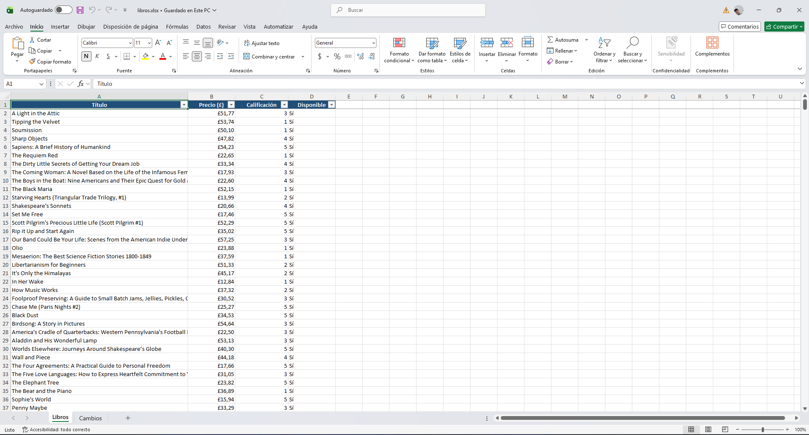
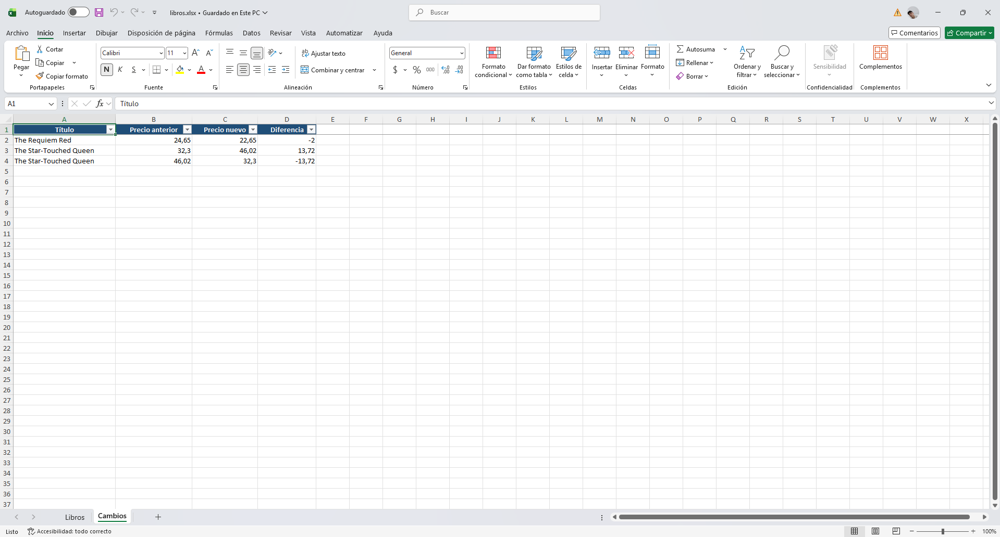

# Price Scraper to Excel

Automatically scrapes product names and prices from an online store, exports them
to a formatted Excel file, and detects price changes between runs.

## What it does

- Scrapes all 50 pages (1,000 products) in under a minute
- Exports a clean Excel file with styled headers, filters and a frozen header row
- Compares prices with the previous run and creates a **Cambios** (Changes) sheet
  showing old price, new price and difference

## Why it matters

Replaces hours of manual copy-pasting and helps you spot price drops or increases
without checking the website every day.

## Tech stack

Python, Requests, BeautifulSoup, pandas, openpyxl

## Installation

    python -m venv venv
    venv\Scripts\activate
    pip install -r requirements.txt

## Usage

    python app.py

The script creates `libros.xlsx` and saves a price history in
`historial_precios.csv`. On the next run, any price differences appear in a
second sheet called **Cambios**.

## Adapting it to your store

This demo uses [books.toscrape.com](https://books.toscrape.com), a site made for
scraping practice. I can adapt the scraper to any e-commerce site: custom fields,
scheduled daily runs, and email or Telegram alerts.

## Contact

Available for freelance work on Upwork and Fiverr.
